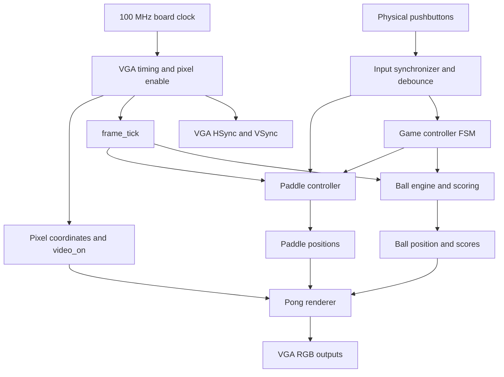

# System Architecture

## 1. Overview

The Pong design is split into small Verilog modules. Each module has one main job. The modules connect in the top-level module, pong_top.

The planned data flow is:

1. The 100 MHz board clock drives the synchronous design.
2. VGA timing creates a pixel-enable pulse, pixel coordinates, sync signals, active-video, and a frame tick.
3. The renderer uses the current pixel coordinates and game-object positions to produce RGB.
4. The input conditioner cleans the physical pushbutton signals.
5. The paddle controller updates paddle positions.
6. The ball engine updates ball position and scores.
7. The game controller decides whether the game is ready, playing, paused, or over.

## 2. Block diagram

## 3. Module responsibilities

### pong_top (Member 1)

- Connects the board clock and reset.
- Instantiates all project modules.
- Connects the button inputs and VGA outputs.
- Connects the game-state signals and object positions.
- Contains the final board-level port names used by the XDC file.

### vga_timing (Member 2)

Suggested inputs:
- clk100
- reset

Suggested outputs:
- pixel_ce
- pixel_x[9:0]
- pixel_y[9:0]
- video_on
- hsync
- vsync
- frame_tick

Initial 640 x 480 timing target:

| Horizontal section | Pixel clocks |
|---|---:|
| Active display | 640 |
| Front porch | 16 |
| Sync pulse | 96 |
| Back porch | 48 |
| Total | 800 |

| Vertical section | Lines |
|---|---:|
| Active display | 480 |
| Front porch | 10 |
| Sync pulse | 2 |
| Back porch | 33 |
| Total | 525 |

The standard 640 x 480 mode uses a nominal pixel clock of about 25.175 MHz and negative-going sync pulses. The first implementation may use a 25 MHz pixel enable derived from 100 MHz, then must be checked on the actual monitor. With 800 x 525 totals, 25 MHz gives approximately 59.5 frames per second.

For the values above, the usual sync intervals are:
- Horizontal sync low when pixel_x is from 656 through 751.
- Vertical sync low when pixel_y is 490 or 491.
- Active video when pixel_x is less than 640 and pixel_y is less than 480.

These are starting values. Verify the module's counter convention and testbench boundaries carefully.

### pong_renderer (Member 2)

Suggested inputs:
- pixel_x, pixel_y
- video_on
- p1_y, p2_y
- ball_x, ball_y
- score1, score2

Suggested output:
- rgb[11:0] for 4 bits each of red, green, and blue, subject to confirmation against the board's VGA interface.

The renderer should decide the colour of the current pixel. It should not update the ball, paddle, or score registers. Those values come from the game modules.

### input_conditioner (Member 4)

- Synchronizes asynchronous pushbutton inputs to clk100.
- Debounces the signals.
- Produces clean button levels or one-cycle press events.
- Uses one documented convention for active-high/active-low signals.

### paddle_controller (Member 4)

Suggested inputs:
- clk100, reset, frame_tick
- game_active
- Clean player direction controls

Suggested outputs:
- p1_y
- p2_y

The paddles must be clamped so their top and bottom edges remain inside the 480-pixel playfield.

### ball_engine (Member 3)

Suggested inputs:
- clk100, reset, frame_tick
- game_active
- p1_y, p2_y
- Agreed paddle and ball dimensions

Suggested outputs:
- ball_x, ball_y
- score1, score2
- A point-scored or round-reset event if the game controller needs one

The ball engine owns the ball's movement, collision decisions, and score update unless the team agrees to split score storage into a separate module.

### game_controller (Member 4)

Suggested inputs:
- clk100, reset
- Clean start/pause/restart button events
- Scores or a winner/point event

Suggested outputs:
- game_active
- paused
- game_over
- Any agreed round-reset or serve-control signal

Suggested states:
- READY
- PLAYING
- PAUSED
- GAME_OVER

The team must agree whether start and pause use one button or separate buttons, and document the behavior.

## 4. Clock and reset rules

- Use the board's 100 MHz clock as the main clock.
- Prefer clock-enable pulses over creating separate clocks for game logic.
- pixel_ce should enable VGA coordinate updates at the effective pixel rate.
- frame_tick should be a one-cycle pulse once per frame and can enable paddle/ball updates.
- Button synchronization and debounce logic should use clk100.
- Agree one internal reset polarity and synchronous/asynchronous reset style before modules are written. Convert the physical board reset polarity in pong_top if needed.
- Do not connect asynchronous pushbuttons directly to game-state registers.

## 5. Proposed button mapping

This is a logical proposal, not a verified pinout:

| Button | Proposed action |
|---|---|
| BTNU | Player 1 up |
| BTND | Player 1 down |
| BTNL | Player 2 up |
| BTNR | Player 2 down |
| BTNC | Start / pause / restart, depending on game state |

Member 1 and Member 4 must verify the physical button names and pin locations using the official constraints for the exact Nexys A7 variant. Update this table if the physical layout or team decision requires a different mapping.

## 6. Interface agreement before coding

Before a member starts a module, the team should write down:

- Exact module name.
- Exact input and output port names.
- Bit width of each port.
- Clock and reset convention.
- Whether a signal is a one-cycle pulse or a held level.
- Which module owns each register.
- When positions and scores are updated.

If a port changes later, the owner must tell the team and update this document or the relevant interface note before merging the change.
